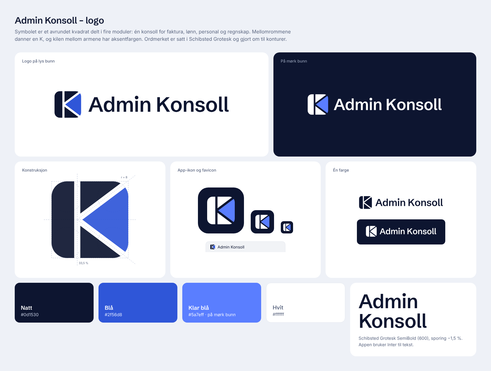

# Merkevaren: Admin Konsoll

## Logoen

- **Symbolet («Modul-K»):** et avrundet kvadrat delt i fire moduler, én konsoll for faktura,
  lønn, personal og regnskap. Mellomrommene mellom modulene danner en K, og kilen mellom armene
  har aksentfargen.
- **Ordmerket:** «Admin Konsoll» i Schibsted Grotesk SemiBold (600) med sporing −1,5 %, gjort om
  til konturer. Skriften har åpen lisens (SIL Open Font License). Appen bruker Inter til tekst.

## Filene

| Fil | Bruk |
|---|---|
| `admin-konsoll-logo.svg` / `.png` | Logoen på lys bunn |
| `admin-konsoll-logo-negativ.svg` / `.png` | Logoen på mørk bunn |
| `admin-konsoll-symbol.svg` | Symbolet alene |
| `admin-konsoll-app-ikon.svg` / `.png` | App-ikonet (symbolet på nattblå flate) |

I appen: `web/src/Logo.tsx` (stiene ligger i `web/src/logoStier.ts`), `web/public/favicon.svg`
og app-ikonene i `web/public/ikoner`. Fargene i appen settes med `--logo-farge` og `--logo-kile`
i `web/src/styles.css`.

## Fargene

| Navn | Hex | Bruk |
|---|---|---|
| Natt | `#0d1530` | Symbolet og ordmerket på lys bunn, app-ikonet og sidemenyen |
| Blå | `#2f56d8` | Kilen på lys bunn, og aksentfargen i appen |
| Klar blå | `#5a7eff` | Kilen på mørk bunn |
| Hvit | `#ffffff` | Symbolet og ordmerket på mørk bunn |

Når bare én farge er mulig, står hele logoen i nattblått eller hvitt, også kilen.

## Bruk

- **Luft:** hold minst en firedel av symbolets høyde fri rundt hele logoen.
- **Minste størrelse:** logoen 20 px høy, symbolet 16 px. Under 24 px brukes favicon-utgaven, som
  har bredere mellomrom.
- **Ikke:** strekk eller roter logoen, gi den skygge, glød eller fargeovergang, bruk andre farger
  enn de over, sett ordmerket i en annen skrift, eller flytt symbolet og ordmerket i forhold til
  hverandre.

## Geometrien

Symbolet tegnes på 48 × 48. Kvadratet går fra 4 til 44 og har hjørneradius 8. Det loddrette
mellomrommet står ved 33,5 % av bredden, og diagonalene går fra midten av stammen til de to
hjørnene til høyre. Mellomrommene er 3,2 enheter brede (4 i favicon, 4,4 i varselmerket).
Ordmerket har versalhøyde 22 enheter, er sentrert på symbolet og står 11 enheter fra det.
